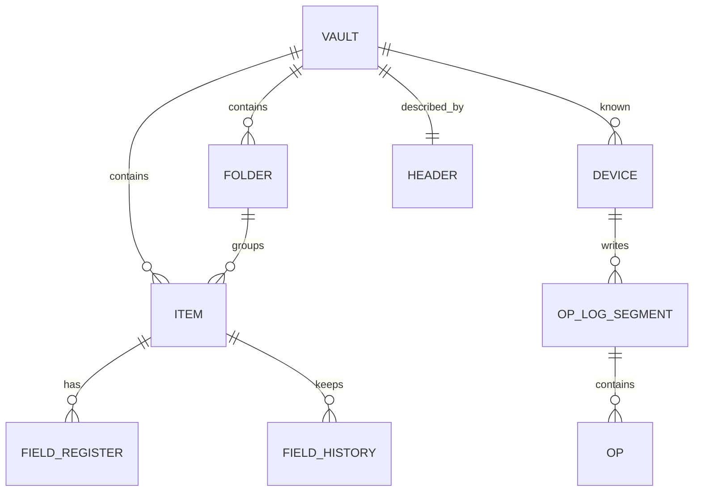

# 05 — Data Model

## 1. Concepts
- **Vault:** one per user per `vault_id`. Contains items, folders, settings.
- **Item:** a typed record. Internally a **map of field registers** (each field is a last-writer-wins register; see doc 06).
- **Field register:** `(key, value, hlc, device_id, base_hlc)`.
- **Op:** a single mutation `set(field)`; deletion/restoration are ops on the `deleted` field.
- **History:** older register values retained for restore.

## 2. Item types and fields

| Type | Standard fields |
|---|---|
| `login` | title, username, password, urls[], totp_seed, notes, custom[] |
| `note` | title, body (Markdown, ≤1 MiB), tags |
| `card` | title, holder, number, expiry, cvv, pin, notes |
| `identity` | title, name parts, email, phone, address, ids, notes |
| `wifi` / `custom` (P2) | arbitrary labeled fields |

Common fields on every item: `id` (UUIDv7), `type`, `folder_id`, `tags[]`, `favorite`, `created_at`, `deleted` (bool, tombstone), `deleted_at`, `schema_version`.

Custom fields: `{ id, label, kind: text|hidden|url|date, value }` stored as individually addressable registers (`custom.<id>.value`, `custom.<id>.label`).

## 3. Identifiers
- Item/folder IDs: UUIDv7 (time-ordered, generated locally; collision-free without coordination).
- Op IDs: `(device_id, seq, index)` — unique and idempotent.
- Device ID: 16 random bytes generated at first launch of the app on that device; stable until app data is erased.

## 4. Conceptual model (ER)



## 5. Local database schema (SQLCipher, inside the encrypted file)

```sql
-- metadata
CREATE TABLE meta (
  key TEXT PRIMARY KEY, value BLOB NOT NULL
);  -- schema_version, vault_id, device_id, epoch, header_version, hlc_state

CREATE TABLE item (
  id BLOB PRIMARY KEY,           -- 16B UUIDv7
  type TEXT NOT NULL,
  folder_id BLOB,
  deleted INTEGER NOT NULL DEFAULT 0,
  deleted_hlc INTEGER,
  updated_hlc INTEGER NOT NULL   -- max of its field hlcs, for sorting
);

CREATE TABLE field (
  item_id BLOB NOT NULL REFERENCES item(id),
  key TEXT NOT NULL,             -- e.g. "title","password","custom.<id>.value"
  value BLOB,                    -- CBOR-encoded value
  hlc INTEGER NOT NULL,          -- 64-bit packed HLC
  device_id BLOB NOT NULL,
  base_hlc INTEGER,              -- hlc of the version the author saw (ancestry graph, doc 06 s5.3)
  PRIMARY KEY (item_id, key)
);

CREATE TABLE field_history (
  item_id BLOB NOT NULL, key TEXT NOT NULL,
  value BLOB, hlc INTEGER NOT NULL, device_id BLOB NOT NULL,
  base_hlc INTEGER,              -- needed to compute concurrent versions at read time
  PRIMARY KEY (item_id, key, hlc, device_id)
);

CREATE TABLE folder (
  id BLOB PRIMARY KEY, name TEXT NOT NULL, parent_id BLOB,
  hlc INTEGER NOT NULL, device_id BLOB NOT NULL, deleted INTEGER NOT NULL DEFAULT 0
);

-- sync state
CREATE TABLE local_op (          -- ops not yet uploaded
  seq INTEGER PRIMARY KEY AUTOINCREMENT,
  item_id BLOB NOT NULL, key TEXT NOT NULL, value BLOB,
  hlc INTEGER NOT NULL, base_hlc INTEGER
);
CREATE TABLE outbox (            -- frozen segments awaiting confirmed upload (doc 06 s6)
  seq INTEGER PRIMARY KEY,       -- this device's segment number
  bytes BLOB NOT NULL,           -- exact encrypted envelope; retries re-send identical bytes
  uploaded INTEGER NOT NULL DEFAULT 0
);
CREATE TABLE manifest_seen (     -- highest manifest counter seen per device (rollback detection)
  device_id BLOB PRIMARY KEY, counter INTEGER NOT NULL
);
CREATE TABLE segment_seen (      -- per remote device
  device_id BLOB NOT NULL, seq INTEGER NOT NULL, hash BLOB NOT NULL,
  applied_at INTEGER NOT NULL, PRIMARY KEY (device_id, seq)
);
CREATE TABLE device (
  device_id BLOB PRIMARY KEY, name TEXT, first_seen INTEGER, last_seen INTEGER, revoked INTEGER DEFAULT 0
);
CREATE TABLE provider_state (    -- cursor tokens, etags (no secrets)
  provider TEXT PRIMARY KEY, cursor TEXT, updated_at INTEGER
);

-- search (decrypted index lives only inside the encrypted DB)
CREATE VIRTUAL TABLE item_fts USING fts5(title, username, urls, notes, tags, content='');
```

Indexes:

| Index | Since schema | Purpose |
|---|---|---|
| `item(type,deleted)`, `item(folder_id)`, `field(item_id)`, `field_history(item_id,key)` | 1 | filters, per-item reads |
| `field_title_cover`, `field_favorite_cover` (partial covering, `key = 'title'` / `'favorite'` only) | 2 | the title and favorite of every item without a table scan |
| `item_visible_updated(visible, updated_hlc DESC, id)` | **3 (proposed)** | list order and visibility without sorting or per-row checks (section 5.1) |

Every index holds only data that is already in the same encrypted database, and no secret field is
copied into one (SEC-S05). `item_visible_updated` holds the item id, `visible` and `updated_hlc`, nothing else.

### 5.1 Listing and paging (proposed, schema 3)

**Problem (measured, `docs/reviews/m2-windows-evidence.md`):** with 20,000 items a `list` call costs
about 75-120 ms *whatever the page size* (1 row costs the same as 50). Cause: the list query
sorts every `item` row by `updated_hlc DESC, id` and loads them all before the page is cut, because
there is no index for that order. A scrolling list pays it once per page.

**Required behaviour (unchanged for callers):**
1. Order: `updated_hlc` descending, then `id` ascending. A page `[offset, offset + limit)` of that
   order is exactly what it is today; only the cost changes.
2. Visibility: an item is listed when `deleted = 0`, or when it is a tombstone whose registers say it
   is visible again (a later undelete wins; section 7; the rule is `is_visible` in
   `core/crates/vault/src/engine.rs`: not deleted, or some register other than the deletion
   bookkeeping is newer than the deletion). Paging must apply this rule *before* `offset`/`limit`
   count rows, so that a page never comes back short because of hidden rows.
3. Filters (type, folder, tag, favorites) apply before paging, as today.

**Change:**
- New column `item.visible INTEGER NOT NULL DEFAULT 1`: the result of the visibility rule above,
  stored. It is derived data, and it is written in the one place that already derives the rest of
  the `item` row from its registers (`item_row`, called after every local edit, every applied
  remote op and every import), so there is no second code path that can forget it. Nothing outside
  the local database sees it: not synced, not exported, not in a segment or snapshot.
- Migration `v003`: `ALTER TABLE item ADD COLUMN visible ...`, then one pass that recomputes
  `visible` for every tombstone row from its registers (live rows are 1 by default), then
  `CREATE INDEX item_visible_updated ON item(visible, updated_hlc DESC, id);`. Normal migration
  path: backup first, one transaction, `schema_version = 3`.
- Query: with only `type` and/or `folder_id` filters (no tag, no favorites), read
  `WHERE visible = 1` in `updated_hlc DESC, id` order and stop at `offset + limit`: a single index
  range read, no sort, no per-row tombstone check. Filters that need the bulk field scans (tag,
  favorites) keep the current path but use `visible = 1` instead of loading registers per tombstone.
- No change to the wire format, the sync protocol, the header or any exported file. A vault written
  by schema 3 is read by older builds only if they refuse unknown schema versions cleanly (the
  existing rule: an app never opens a newer schema than it knows).

**Tests required before the code PR merges:**
- Migration test from a golden schema-2 vault to 3, and the golden schema-1 chain (1 to 2 to 3).
- Property test: for random vaults (live items, tombstones, undeleted items, equal `updated_hlc`),
  the paged list equals the current implementation's output for every `(offset, limit)`.
- Invariant test: after every kind of write (local edit, delete, undelete, remote op applied in
  any order, import, purge, restore), `item.visible` equals `is_visible(registers)` for every item;
  and a migration test where the column is recomputed for tombstones that are visible again.
- Page-never-short test with hidden tombstones before the page.
- Benchmark kept in `l02_bench`: `list` at 20,000 items must not depend on `limit` (limit 1 within
  1.5x of limit 50) and a page of 50 must take **under 16 ms** on the reference laptop (one frame at
  60 Hz; today 75 ms; owner decision, to be re-measured once built).

**Alternatives considered:** a session-side cache of the sorted id list (no on-disk change, but
more state to invalidate on every write and on every sync apply, and still a 100 ms first call);
paging in SQL without the index (still sorts 20,000 rows per call); a second read for tombstones
that may be visible again (no new column, but a merge of two ordered reads and a per-tombstone
register load, rejected by the owner in favour of the stored column).

**Decisions recorded (owner, 2026-10-14):** the bar is 16 ms per page of 50; visibility is stored
in a column rather than recomputed.

**Open questions for review:** (a) the column is another invariant: is the invariant test above
enough, or should a debug-build assertion re-derive and compare on every write? (b) should
`visible` also drive search and the trash view (`list_trash`), or stay list-only for now?
